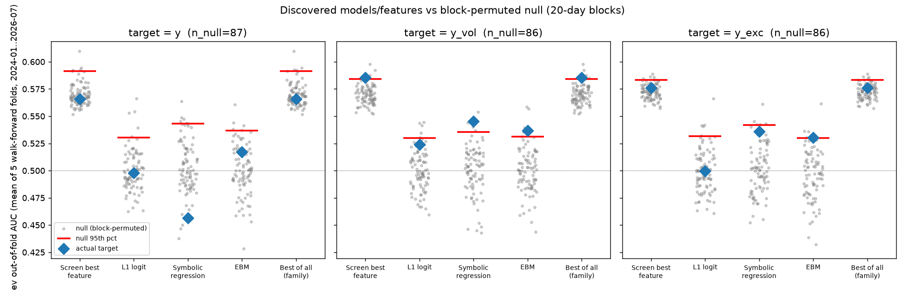
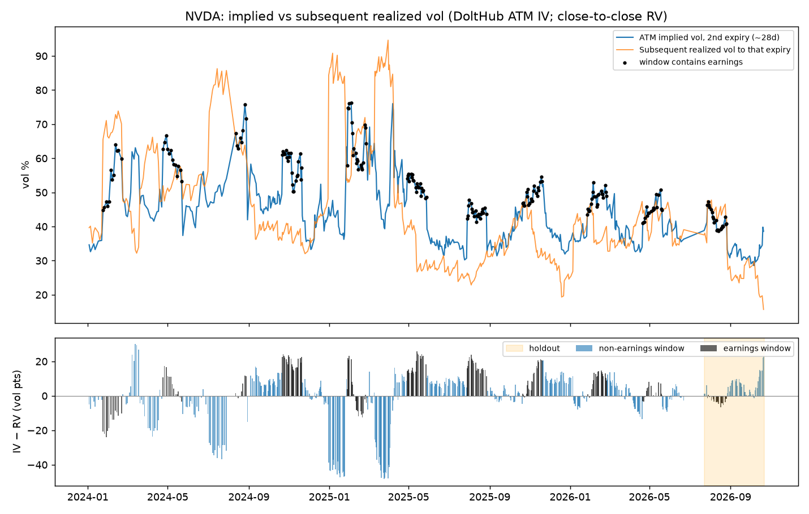
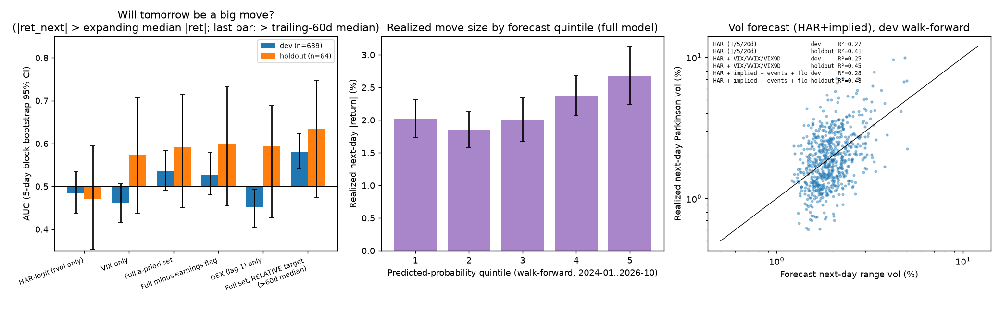
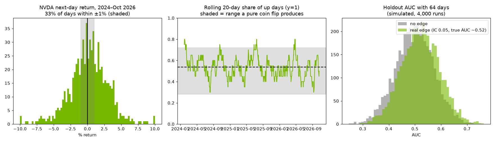

# NVDA next-day direction: what we tried and why it does not work

A research log, with code, on one question: can free public data tell us whether NVDA closes higher tomorrow? Short answer: no, not with anything we could validate. This repository documents the attempt, the tests that failed, and the few descriptive findings that held up.

It is a negative-result project. Nothing here is a trading signal, and nothing here is investment advice.

## Contents

1. [The question](#the-question)
2. [Data](#data)
3. [Methods](#methods)
4. [Studies and results](#studies-and-results)
5. [Insights](#insights)
6. [Why it doesn't work](#why-it-doesnt-work)
7. [What it would take to go further](#what-it-would-take-to-go-further)
8. [Repository layout and status](#repository-layout-and-status)
9. [Reproducibility](#reproducibility)
10. [License](#license)

## The question

For each trading day *t*, using only information available by 6:00 p.m. ET on day *t*, predict

- `y = 1` if NVDA's close on the next trading day is above its close on day *t* (up),
- `y = 0` otherwise (not up). Ties count as 0.

The label is "up (1) vs not up (0)". The last row of the sample has no label and is dropped. Some studies use related targets, defined where they appear: a vol-scaled move target (`y_vol`), an excess-return target against SMH (`y_exc`), and intraday targets.

## Data

Free sources only. No API keys. Downloaders send a descriptive User-Agent where a source asks for one. SEC EDGAR requires that contact to be yours: set `NVDA_USER_AGENT_EMAIL` to an email you control before running the downloaders (`pipeline/01_download.py`, `pipeline/01b_parallel.py`). If it is unset, those scripts print a reminder and send a non-routable fallback, which does not meet the SEC policy.

| Source | Used for |
|---|---|
| Yahoo Finance (yfinance) | NVDA, market, sector, peer, mega-cap, bond, credit, commodity and dollar ETFs |
| FRED and ALFRED | Rates, real yields, credit spreads, dollar index; first-release vintages for CPI, payrolls, PCE, PPI, JOLTS |
| Cboe | VIX family, daily put/call statistics |
| U.S. Treasury | Par yield curve |
| Coinbase Exchange | BTC and ETH hourly candles, sampled at 18:00 ET |
| SEC EDGAR | NVDA filings, timed on acceptance timestamp |
| FOMC, BLS, BEA calendars | Scheduled event dates |
| SqueezeMetrics, GraniteShares, FINRA | SPX dealer gamma (GEX), leveraged-ETF AUM (NVDL, NVD), daily short volume (off-exchange only) |
| Dukascopy | 1-minute NVDA and QQQ bid candles (CFD feed) for the intraday studies |
| DoltHub `post-no-preference/options` | At-the-money implied vol by expiry, for the vol study |

Windows:

- **Main window:** 2024-01-02 onward. Warm-up history from 2022 is used only to compute lookbacks, never as training rows.
- **Development end:** 2026-07-21. 2026-07-22 is purged as an embargo day.
- **Locked holdout:** 2026-07-23 to 2026-10-21 (64 sessions). Every study scored its final model on the holdout once, with rules frozen beforehand.
- **Point-in-time cutoff:** every feature for day *t* may use only information timestamped at or before 18:00 ET on day *t*. Slower series are lagged (FRED daily: 1 business day; Cboe put/call and Treasury yields: 1 session because posting times were not verified; monthly macro: usable from the release date, using first-release vintages). Full rules are in `spec/Leakage_and_Timing_Rules.csv`.

Study 1 also used three development windows (A from 2024-01-02, B from 2024-11-06, C from 2026-03-31). All share the same holdout.

One caveat applies to the whole project: all studies use the same 64-session holdout. After the first study scored it, the holdout was no longer untouched for later work. Later studies froze their rules before scoring it, but any new work needs a fresh forward period.

## Methods

- **Walk-forward evaluation with an embargo.** Expanding training windows, validation blocks after them, and a gap of at least one session (the flows study embargoes for the holding horizon; the vol study leaves 5 trading days between a training target window and the refit date).
- **Nested tuning.** Study 2 tunes hyperparameters in an inner expanding walk-forward loop inside each outer training set. Study 1 did not nest feature selection inside the folds, which is why its development scores are biased (see below).
- **Block-bootstrap confidence intervals.** 95% intervals from moving-block or stationary block bootstraps (blocks of 5 to 10 trading days, 1,000 to 2,000 draws), so autocorrelation is respected.
- **Block-permutation nulls.** Signals or targets are shuffled in 20-day blocks. In the discovery study the whole pipeline (screen, L1 logit, symbolic regression, EBM) is rerun on permuted targets, 86 to 87 times per target, so the null already pays for searching 1,403 candidate features.
- **Pre-registration.** Studies 2, flows, close-window and vol each have a `PREREG` file written before any result was computed. Study 2's file is hashed (sha256 `d2f9e2499ff2035fc8996a1a6e674357542b25f95145fea9df98abb0abc1a1dd`). Deviations are listed in the results (Study 2 has two, both metric fixes).
- **Multiple-testing correction.** Holm across each pre-registered family (flows: 14 tests; close-window: 4; vol: 5). Benjamini-Hochberg for event tables (38 tests in the insights study). Cells outside a family are labeled exploratory and are not corrected.
- **Metrics.** AUC, accuracy against the base rate, log loss, Brier score, and rank information coefficient (IC). Minimum detectable effects (MDE) are computed for each sample at 80% power and a two-sided 5% test.

## Studies and results

All numbers below come from the study files. Holdout n is 64 unless stated.

### Study 1: feature-selection funnel (daily direction)

Built 247 point-in-time model columns from a catalog of 255 features (9 excluded for missing free sources). A funnel (data quality, redundancy, univariate, multivariate, economic logic) cut each window to a final set of 25 features (A, B) or 15 (C). Models: base rate, L2 logistic regression, shallow LightGBM, each on the full and reduced sets.

Development walk-forward AUC for the reduced sets was 0.59 to 0.74. On the holdout it was 0.25 to 0.48:

| Window | Model (reduced set) | Dev walk-forward AUC | Holdout AUC [95% CI] |
|---|---|---|---|
| A (388 OOS rows) | logistic | 0.592 | 0.479 [0.35, 0.60] |
| A | LightGBM | 0.588 | 0.439 [0.30, 0.53] |
| B (200 OOS rows) | logistic | 0.619 | 0.411 [0.27, 0.56] |
| B | LightGBM | 0.605 | 0.343 [0.22, 0.44] |
| C (36 OOS rows) | logistic | 0.738 | 0.252 [0.14, 0.36] |
| C | LightGBM | 0.660 | 0.262 [0.13, 0.39] |

- The development scores are optimistic because selection used the same validation folds. Holdout AUC is significantly below 0.5 for window B LightGBM and for both window C models. We read it as overfitting plus regime instability, not as a contrarian signal.
- The full-feature window A logistic model scored holdout AUC 0.522 [0.39, 0.68] and accuracy 57.8%, with log loss 0.861 against 0.700 for the base rate, so its probabilities were badly calibrated out of sample.
- Final sets barely overlap: Jaccard 0.28 (A and B), 0.03 (A and C), 0.08 (B and C). Only `hyg_lqd_ratio_chg_5d` is in all three.
- Holdout up-rate was 48.4%, against 53.4% in the window A development period.

MDE for this design: about +7.1 accuracy points (AUC 0.582) for window A, +9.9 points (AUC 0.615) for B, +23.3 points (AUC 0.773) for C, and +17.5 points (AUC 0.704) for the 64-session holdout. Realistic daily-direction edges are 1 to 3 accuracy points (AUC about 0.51 to 0.53). None of these samples can confirm or reject an edge that small.

### Study 2: pre-registered composites with nested tuning

Eight a-priori signed composites (semis peer momentum, NVDA reversal and vol, credit risk appetite, dollar and rates, options fear, forced flow, beta and correlation, event timing). Elastic-net logistic regression with inner nested tuning. Targets `y`, `y_vol`, `y_exc`. Regimes: quiet vs event days. Dev: 639 rows, 388 walk-forward OOS rows over 6 folds. Holdout: 64 rows (38 quiet, 26 event).

- **H1 (primary): quiet-day predictability fails.** Nested tuning picked the all-zero model in 6 of 6 development folds and in the holdout fit, so the prediction equals the base rate (holdout AUC 0.500). An earlier exploratory quiet-day AUC near 0.62 did not survive a clean test.
- **H2 (quiet days more predictable than event days) is not supported.** For `y` the models were null. For `y_vol`, the pooled development AUC gap was +0.076 [-0.04, +0.19], and on holdout event days `y_vol` AUC was 0.242 [0.04, 0.48], significantly worse than the base rate.
- **H3 (a quiet-only model beats the base rate) fails.** Log-loss gain intervals include 0 in every cell. The best holdout cell (`y_exc`, quiet-only model, AUC 0.678 [0.52, 0.80]) is one of about 48 cells, has no development support (0.531 [0.47, 0.59]), and is consistent with chance.
- **H4 (an event or VIX flag marks unpredictable days) fails.** No flag meets the pre-registered rule.
- **No composite has a stable monthly IC.** The pre-registered within-month IC flagged three composites (forced flow, options fear, reversal) as stable. That was a small-sample bias (a simulation with true IC 0 gave a mean of +0.23). With the corrected uncentred IC none is stable; the largest dev |t| is 1.97 (beta and correlation, wrong sign).
- **Instability again:** the one non-null `y` fit (residual feature set) scored holdout AUC 0.304 [0.15, 0.42], a significant reversal.
- **Power:** MDE in AUC above 0.5 is 0.082 (dev, all days) and 0.204 (holdout, all days); on quiet days 0.099 and 0.266.

### Discovery: 1,443 computed features against a block-permuted null

54 raw series, 25 pair spreads and ratios, many trailing transforms and 120 pairwise products: 1,443 candidates (1,403 after de-duplication). Four engines (univariate screen, L1 logit, symbolic regression, explainable boosting machine) under 5-fold walk-forward, compared with the same pipeline rerun on block-permuted targets.

- **`y` and `y_exc`: no survivors.** Best-of-all AUC for `y` was 0.566 against a null 95th percentile of 0.591 (p = 0.65).
- **`y_vol`** (a target of next-day return above +0.25 of trailing 20-day vol) cleared the null only barely (p about 0.02 to 0.05 per engine), which is what chance looks like across 3 targets and 4 engines. Its one survivor, distance of NVDA above its 60-day low, scored holdout AUC 0.632 [0.495, 0.815]. The symbolic-regression result for the same target was largely mechanical (low realized vol relative to implied predicts vol expansion) and did not hold on the holdout (0.517).
- Explainable-boosting interaction terms were unstable: top-10 lists from the full fit and the fold-averaged fit overlapped in 0 to 2 terms.



*Development out-of-fold AUC (mean of 5 walk-forward folds) for each engine (blue diamonds), against 86 to 87 block-permuted reruns (grey dots) and their 95th percentile (red lines). For `y` and `y_exc` every diamond sits inside its null cloud; `y_vol` clears it only barely.*

### Insights: what drives NVDA price action (descriptive)

Factor decomposition, move-size forecasting and event studies over 2024-01 to 2026-10. Findings are in [Insights](#insights).

### Intraday: the opening window and the rest of the day

Dukascopy 1-minute bars, 678 usable sessions (2024-01-24 to 2026-10-21). Price fidelity against yfinance was high (median close difference 0.6 bp, 5-minute return correlation 0.998); volume from the CFD feed is not usable.

- **No model beats its block-permutation null for rest-of-day or last-30-minute direction on development data** (rest-of-day AUC 0.506 [0.454, 0.561] against a null 95th percentile of 0.523, p = 0.15).
- Holdout AUCs of 0.59 to 0.69 have intervals that touch 0.5, and a model using only the prior day scores 0.675 there. That looks like the regime and the 45% holdout up-rate, not an opening-window effect.
- Descriptive only: P(last 30 minutes up | first 15 minutes up) = 0.564 [0.510, 0.614] against 0.482 [0.432, 0.532] after a down first 15 minutes. With about 60 cells examined, this does not survive a multiple-testing caveat.
- Move size is predictable (rest-of-day range, development out-of-sample R2 0.11 to 0.14), but prior-day volatility already carries most of it (0.13).

### Flows: forced and mechanical flows, daily horizon

Pre-registered, 14 primary tests, Holm correction, 2 bps per side costs. Hypotheses: leveraged-ETF rebalancing (NVDL 2x, NVD -2x), options-expiration pinning, post-earnings drift, turn of month, vol-target and trend-following de-risking, short covering.

- **Leveraged-ETF rebalance: null.** Controlling for the day's return, flow scaled by dollar volume explains the next-day gap with a coefficient of -11 bps per SD [-38, +18], p = 0.44. The overnight-fade rule lost money in development (Sharpe -1.47).
- **Options expiration:** pinning ratio 0.97 [0.88, 1.06]. Range compression showed up only when SPX dealer gamma was high (0.90 against 1.08 when low, p = 0.08, weak), which is about move size and not direction.
- **Post-earnings drift:** NVDA alone (n = 10) +1.5% [-1.0, +4.0]; pooled semis (n = 111) +1.0% [+0.2, +2.1], p = 0.06, and absent in 2022-23 and in the holdout.
- **Turn of month, vol-shock and trend-flip rules:** null in development. The turn-of-month holdout spike (+212 bps over 12 days) contradicts development and 2022-23.
- **Short covering:** the only Holm survivors (P13 -3.3% [-6.2, -1.0], P14 -2.5% [-4.2, -0.9], both Holm p = 0.028, 5-day forward returns) went against the squeeze hypothesis, were mostly market-wide (the beta-hedged rule has Sharpe 0.07), and did not confirm out of sample (P13 same sign, n = 8, not significant; P14 flipped).
- None of the timing rules beat NVDA buy-and-hold in development (Sharpe 1.43).

### Flows, close window: last 30 minutes and the closing auction

Pre-registered, 4 tests, Holm. Does estimated leveraged-ETF rebalance flow, scaled by AUM over average dollar volume, move the last 30 minutes or the next morning?

- Development effects per 1 SD of flow: -7.1 bps [-15.4, +1.5] for the last 30 minutes (wrong sign), +2.2 bps [-35, +44] for close to next open, +16.8 bps [-33, +69] for close to next 10:00. All Holm-adjusted p-values are 0.64 or higher. The trading rule had a Sharpe of 0.12 after costs (181 trades).
- Scaling by fund size adds nothing beyond plain intraday momentum, which is weak but real (+4.0 bps per SD of the morning return [+0.7, +7.7]). The only flow-consistent sign was the closing-auction leg (exploratory): +1.8 bps per SD [+0.5, +2.8], a decile spread of about 3.5 bps, below round-trip cost. It was -3.6 bps [-13, +10] on the holdout.
- Caveat: the bid-price feed sits about 2.5 bps below the official close, and there is no auction-imbalance data.

### Vol edge: does our realized-vol forecast beat NVDA implied vol?

Pre-registered, 5 tests, Holm. A point-in-time HAR plus VIX plus GEX forecast against at-the-money implied vol from DoltHub, with a delta-hedged ATM straddle held to expiry as the trading proxy (P&L approximately (IV^2 - RV^2) / (2 IV), less costs).

- **No timing edge.** All 5 primary tests are null after Holm correction (best: 1-day proxy IC 0.08, Holm p = 0.28). The holdout is null too.
- **Implied vol encompasses the forecast.** In log RV^2 = a + b log IV^2 + c log F (front expiry), b = 0.94 (se 0.28) and c = -0.08 (se 0.31). Implied vol's correlation with realized vol is 0.48, against 0.32 for our forecast.
- **Outside earnings the premium was about zero.** Non-earnings 2-week IV minus subsequent realized vol was -0.8 vol points [-4.9, +3.0]; always selling front-expiry vol lost 5.2 vol points per trade net of costs. Earnings windows are different (+13.9 [+9.8, +18.9] at window level), but at event level (n = 10) realized move over implied move was 0.74 [0.43, 1.06], and 1.70 for the one holdout event.



*Top: at-the-money implied vol (second expiry, about 28 days) and the realized vol that followed, with windows containing earnings marked in black. Bottom: IV minus RV in vol points, with the holdout shaded.*

## Insights

These are descriptive findings with confidence intervals. They explain NVDA's behavior but do not give a usable direction forecast.

1. **NVDA has become more idiosyncratic.** The share of squared returns not explained by out-of-sample factor betas rose from 19% in 2022 to 72% in Jul-Oct 2026. The QQQ-only beta fell from 2.4 (Jul-Nov 2024) to 1.1. Rolling R2 is in-sample, and the regime windows were chosen from the price path after the fact.
2. **What explains the variance (2024-26 Shapley R2 shares):** QQQ 0.22, semis peers ex-NVDA 0.15, change in VIX 0.08, hyperscalers 0.07, credit 0.04. The 10-year yield and the dollar add less than 0.01 combined at a daily horizon.
3. **Macro days are factor days, not big NVDA days.** The idiosyncratic share of variance is 0.28 on FOMC days and 0.36 on CPI days, against 0.52 on days with no event, and NVDA's same-day move is not significantly larger on CPI, FOMC or jobs days. Earnings reaction days do: 2.2x trailing vol [1.3, 3.3], n = 11.
4. **The size of the next move is forecastable; its direction is not.** A HAR volatility model reaches out-of-sample R2 of 0.27 [0.19, 0.33] on development data and 0.41 [0.27, 0.56] on the holdout for next-day range. A scheduled earnings date the next day roughly doubles the expected range (x1.9). Close-to-close absolute return is far noisier (R2 0.05).
5. **A binary "big move" target is capped by noise.** Target: next-day absolute return above its trailing 60-day median. A regularized logistic model with nested tuning reached AUC 0.58 [0.54, 0.62] (dev, n = 639) and 0.64 [0.48, 0.75] (holdout, n = 64, scored once). In simulation a perfectly specified vol forecast reaches only about 0.60 [0.56, 0.65].
6. **Low SPX dealer gamma goes with wider NVDA ranges.** Lowest against highest lagged-GEX quintile: next-day range 2.55% vs 1.68% in development and 1.91% vs 1.34% in the holdout (Spearman -0.27 and -0.28). It predicts size, not direction.
7. **No condition gives reliable next-day direction.** Of 14 next-day-return conditions across 38 tests, none survives Benjamini-Hochberg (minimum q = 0.36). After large down days the next day averaged +1.30% [-0.22, +2.91] (n = 24) in 2024-26 and -1.06% in 2022-23, so the sign flips.
8. **Leveraged-ETF flows are small.** NVDL and NVD rebalance notional is a median 0.4% of NVDA's daily dollar volume (90th percentile 1.1%, max 1.9%), and top-decile days show no next-day reversal.
9. **Options premium on NVDA lived in earnings windows** in 2024-26 (see the vol study above).



*Left: AUC for "will tomorrow be a big move" (next-day absolute return above its expanding median; the last bar uses the trailing 60-day median), for six feature sets, development (blue, n = 639) and holdout (orange, n = 64), with 5-day block-bootstrap 95% intervals. Middle: realized next-day absolute return by predicted-probability quintile. Right: development walk-forward HAR plus implied-vol forecast against realized next-day Parkinson (range) vol.*

## Why it doesn't work

**1. NVDA's direction looks efficiently priced at daily and intraday horizons, even around forced flows.** We tested leveraged-ETF rebalancing, options-expiration pinning, vol-target and trend-following de-risking, short covering, turn of month, and the closing auction. After correction, none predicts up (1) vs not up (0). The mechanical flows are small next to NVDA's liquidity (median 0.4% of daily dollar volume), and the intraday tests found nothing that beats a block-permutation null.

**2. The target is noise-dominated.** 33% of next-day returns fall within plus or minus 1%. The rolling 20-day share of up days wanders inside the band a pure coin flip produces. Even a perfect volatility forecast caps the AUC of a "big move" label near 0.60. Direction on a single day is mostly the random draw.

**3. Small n and low power.** The holdout has 64 sessions and can detect an AUC of about 0.70 only (0.77 on quiet days). Window A can detect about 0.58. A true AUC of 0.52, which would already be a realistic edge, is invisible in these samples. Event studies are thinner: 10 to 11 NVDA earnings events in the sample, and 3 monthly expirations and 1 NVDA earnings event in the holdout.

**4. Selection overfitting in the first funnel.** Study 1 selected features on the same folds it used to score them. Reduced-set AUC fell from 0.59 to 0.74 in development to 0.25 to 0.48 on the holdout. Against a block-permuted null that includes the penalty for 1,403 candidates, the best AUC for `y` was 0.566 against a threshold of 0.591. Nested tuning in Study 2 shrank the models to the base rate in every fold.

**5. Move size is forecastable, but options already price it.** Realized-vol forecasts have real out-of-sample skill (R2 0.27 to 0.41 for next-day range). But implied vol encompasses our forecast (coefficient on our forecast about 0), and outside earnings the implied-minus-realized gap was about zero (-0.8 vol points). Forecastable size is not tradable edge.

**6. Free-data limits.** Implied vol is at-the-money only (no skew or full surface, and no options inside about 9 days). Intraday prices come from a CFD bid feed with unusable volume. There is no closing-auction imbalance data. FINRA short volume is off-exchange only. The OAS series start in late 2023. Nasdaq Trader volume and a few other catalog features (F128, F129, F131, F250 to F255) were not obtained. Yahoo is an unofficial API whose adjusted history is restated.

The negative result is bounded by the data and the power above. It does not prove that no edge exists. It says that with free daily and 1-minute data and about 2.8 years of history, we could not find one that survives out-of-sample testing.



*Left: distribution of NVDA next-day returns, 2024 to Oct 2026; 33% of days fall within plus or minus 1% (shaded). Middle: rolling 20-day share of up (1) days against the range a coin flip produces (grey band). Right: simulated holdout AUC with 64 days, with no edge vs a real edge (IC 0.05, true AUC about 0.52); the two distributions overlap heavily.*

## What it would take to go further

- **Full options surface data.** End-of-day history with skew and weeklies or 0DTE (for example ORATS, Cboe DataShop or LiveVol, OptionMetrics, ThetaData). That allows proper variance-swap replication, ex-earnings implied vol, implied earnings moves and a true 1-day implied move. Intraday option quotes would allow realistic fills.
- **Peer pooling.** Pool semis peers (AMD, AVGO, MU, TSM and others) to get more earnings events and more independent observations than NVDA's 10 to 11. Pooled post-earnings drift was marginal in development and absent in the holdout, so this needs pre-registration before it is trusted.
- **Auction imbalance data.** Nasdaq closing-cross imbalance and print data, plus actual leveraged-ETF swap exposure and intraday NVDL and NVD data, to test the closing-auction leg properly.
- **A fresh forward period.** The current 64-session holdout has been used by every study. New hypotheses need new, untouched data and a pre-registered test.

## Repository layout and status

Pipeline code (Study 1) is in the repo today. Code for the later studies is **not yet in the repo** and is listed as to-be-added.

| Path | Status | Role |
|---|---|---|
| `pipeline/01_download.py` | in repo | Download free raw series into `data/raw/`. |
| `pipeline/01b_parallel.py` | in repo | Parallel helper for the Cboe daily put/call files. |
| `pipeline/02_features.py` | in repo | Build point-in-time features and the next-day target. |
| `pipeline/03_select_eval.py` | in repo | Selection funnel and model evaluation. |
| `pipeline/04_deliverables.py` | in repo | Write the results spreadsheet. |
| `pipeline/05_report_md.py` | in repo | Write the markdown report. |
| `pipeline/paths.py` | in repo | Data-root resolution (`data/` by default, `NVDA_DATA_DIR` to override). |
| `spec/` | in repo | Feature spec, data sources, leakage rules, target, notes, `windows.json`. |
| `requirements.txt` | in repo | Pinned direct dependencies. |
| Study 2 (composites) | to be added | Pre-registration, `study2.py`, IC and bias-check scripts, deviation log. |
| Discovery | to be added | Feature generation, pipeline, null runs, EBM, holdout script. |
| Insights | to be added | Factor, move-size, event-study and GEX scripts. |
| Intraday | to be added | Dukascopy download, feature build, analysis. |
| Flows (daily and close window) | to be added | Pre-registrations, analysis and holdout scripts. |
| Vol edge | to be added | DoltHub pull, IV parsing, forecast, analysis, pre-registration. |

Market data, model outputs, pickles and spreadsheets are gitignored. Yahoo Finance and Cboe series have licensing restrictions and must not be committed. The same care applies to the other third-party feeds above.

## Reproducibility

- Python 3.11 or newer. `pip install -r requirements.txt` installs the pinned direct dependencies from the environment that produced the study.
- Outputs go to `<repo>/data`. Set `NVDA_DATA_DIR` to put them elsewhere (absolute, or relative to the repo root).
- Set `NVDA_USER_AGENT_EMAIL` to an email you control. SEC EDGAR requires a contact in the User-Agent; the downloaders read this variable and will not supply a real address for you.
- Run Study 1 from the repo root, in order:

```bash
python pipeline/01_download.py
python pipeline/01b_parallel.py
python pipeline/02_features.py
python pipeline/03_select_eval.py
python pipeline/04_deliverables.py
python pipeline/05_report_md.py
```

- The download walks several years of ALFRED vintages and Cboe daily files, and the selection step refits elastic-net and LightGBM models inside each fold with SHAP. Both are slow.
- Downloads append a log to `data/raw/download_log.json`. Yahoo adjusted history is restated over time and several free endpoints are unofficial, so a rerun can differ slightly from the published numbers. The study was run on 2026-10-23, the later studies on 2026-10-23 and 2026-10-24.
- Holdout results are one-shot by design. Re-running a study against the holdout and then changing the model would invalidate it.

## License

Released under the MIT License. See `LICENSE`. Third-party data terms (Yahoo, Cboe, FRED, SqueezeMetrics, Dukascopy, DoltHub) still apply to anyone running the code, and no data is committed here.
